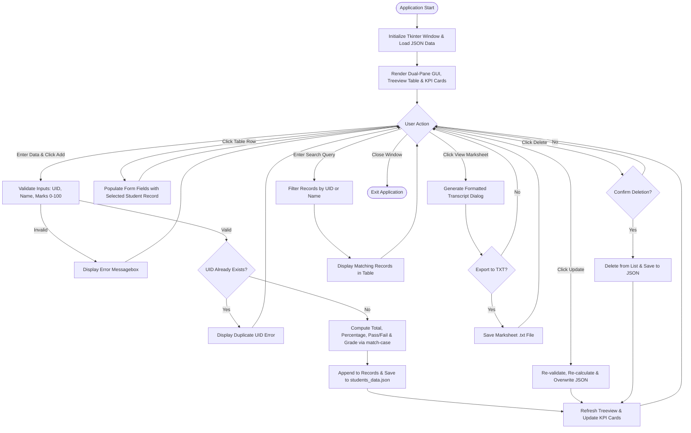
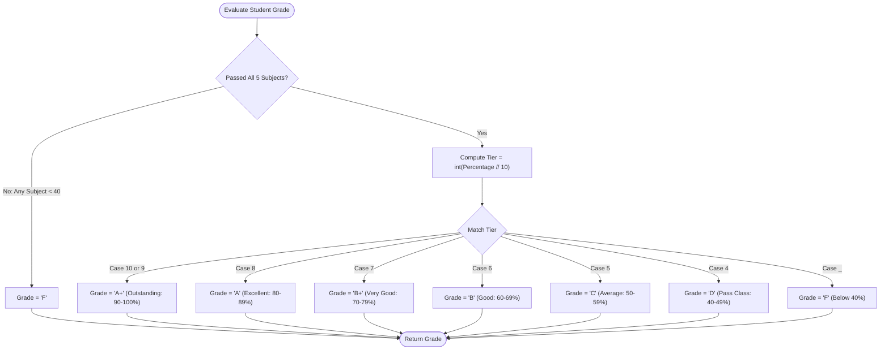

# ACADEMIC PROJECT REPORT

## STUDENT PERFORMANCE & RESULT MANAGEMENT SYSTEM
**Course:** Master of Computer Applications (MCA General) — Semester 1  
**Subject:** Python Programming Lab (Mini Project)  
**Academic Session:** 2026–2027  

---

### Student Credentials:
- **Student Name:** Shivani  
- **University Roll / UID:** 26MCA20231  
- **Section:** 4-A  
- **Course:** MCA General  
- **Semester:** 1st Semester  
- **Department:** Department of Computer Applications  

---

## TABLE OF CONTENTS
1. [Project Title and Abstract](#1-project-title-and-abstract)
2. [Introduction](#2-introduction)
3. [Problem Statement](#3-problem-statement)
4. [Objectives](#4-objectives)
5. [Existing System vs. Proposed System](#5-existing-system-vs-proposed-system)
6. [Software and Hardware Requirements](#6-software-and-hardware-requirements)
7. [System Design and Module Architecture (Syllabus Mapped)](#7-system-design-and-module-architecture)
8. [Algorithm (Pseudo-Algorithm)](#8-algorithm)
9. [Flowchart Diagrams](#9-flowchart-diagrams)
10. [Complete Source Code Listing](#10-complete-source-code-listing)
11. [Step-by-Step Explanation of Code & Syllabus Concepts](#11-step-by-step-explanation-of-code--syllabus-concepts)
12. [How to Run the Application (Execution Guide)](#12-how-to-run-the-application)
13. [Sample Inputs and Outputs](#13-sample-inputs-and-outputs)
14. [Test Cases and Verification Results](#14-test-cases-and-verification-results)
15. [Realistic College-Based Case Study (Illustrative Data)](#15-realistic-college-based-case-study)
16. [Advantages, Limitations, and Future Scope](#16-advantages-limitations-and-future-scope)
17. [Conclusion and References](#17-conclusion-and-references)

---

## 1. PROJECT TITLE AND ABSTRACT

### Project Title:
**Student Performance & Result Management System**

### Abstract:
Academic institutions handle substantial volumes of student assessment data every semester. In traditional workflows, tabulating subject marks, computing aggregate percentages, determining letter grades, and verifying pass/fail status across individual course units is performed manually or via fragmented spreadsheet files. Such manual processes are error-prone, labor-intensive, and lack instant verification and aggregated statistical visibility.

The **Student Performance & Result Management System** is a standalone, beginner-friendly desktop application developed in Python. Designed for the first semester Master of Computer Applications (MCA) curriculum, the project implements a clean graphical user interface using Python's native `tkinter` and `ttk` libraries. The application manages academic scores across five core MCA Semester 1 subjects: *Python Programming*, *Data Structures & Algorithms*, *Computer Architecture*, *Discrete Mathematics*, and *Operating Systems*. 

The system automates the computation of aggregate marks (out of 500), overall percentages, institutional letter grades (using Python 3.10+ `match-case` structural pattern matching), and subject-level pass/fail criteria (minimum 40 marks required per subject). Records are maintained persistently using lightweight JSON serialization. The application provides end-to-end CRUD (Create, Read, Update, Delete) capability, interactive search and filtering, batch class statistics (pass rate, class average, high/low scores), and formal ASCII marksheet generation with file export options. This project fulfills all syllabus requirements of the MCA Semester 1 Python Programming curriculum while delivering a reliable, executable software solution.

---

## 2. INTRODUCTION
Python has emerged as one of the most widely used high-level programming languages globally due to its readable syntax, rich built-in data structures, dynamic typing, and comprehensive standard library ("batteries included"). In the MCA postgraduate curriculum, mastering core Python fundamentals—including variable scoping, flow control structures, modular functions, exception handling, data structures (lists, dictionaries, tuples), and event-driven GUI development—is essential.

The *Student Performance & Result Management System* demonstrates the practical application of these theoretical and laboratory concepts. Rather than running as a detached command-line script, it integrates foundational procedural algorithms (linear search, nested aggregations, pattern matching) inside an event-driven Tkinter desktop environment. The project bridges theoretical logic with real-world institutional administration, enabling faculties and students to track academic milestones transparently.

---

## 3. PROBLEM STATEMENT
Academic administrators, course coordinators, and faculty members face several challenges when processing student marks:
1. **Mathematical Inaccuracy:** Manual summation of multi-subject marks and percentage calculations frequently introduce calculation errors, leading to incorrect grade assignments.
2. **Subject-Wise Passing Oversight:** A student might achieve a high overall average percentage but fail in a single prerequisite subject (scoring below 40%). Manual reviews often overlook this nuance, leading to false promotions.
3. **Redundant Data Entry & Lookup:** Searching for a specific student's score in physical registers or unindexed sheets requires sequential scanning, consuming faculty time during evaluation audits.
4. **Lack of Instant Academic Analytics:** Faculties require immediate insight into class passing rates, failing counts, and subject-wise averages to schedule remedial classes.
5. **Absence of Standardized Transcripts:** Manually writing marksheets causes formatting discrepancies and delays transcript issuance to students.

---

## 4. OBJECTIVES
The primary objectives of this project are:
- **Automation of Academic Calculations:** Compute total marks (out of 500), percentage, and letter grades without manual human intervention.
- **Strict Passing Criterion Implementation:** Enforce subject-wise verification where a score below 40.0 in any of the five subjects marks the student as 'FAIL' and assigns grade 'F'.
- **Interactive Graphical User Interface:** Provide a dual-pane desktop interface allowing quick data entry, instant previewing, and interactive tabular record exploration.
- **Robust Input Validation:** Prevent system crashes and corrupt data by verifying non-empty fields, alphabetic names, and numerical score constraints ($0 \le \text{mark} \le 100$).
- **Data Persistence:** Store and retrieve student records reliably in JSON format without external database server configuration.
- **Comprehensive Reporting:** Generate printable student marksheets and export class-wide performance summary sheets.
- **Educational Alignment:** Explicitly reflect and reinforce every core topic of the MCA Semester 1 Python syllabus.

---

## 5. EXISTING SYSTEM VS. PROPOSED SYSTEM

| Feature / Dimension | Existing Manual / Spreadsheet System | Proposed Python Management System |
| :--- | :--- | :--- |
| **User Interface** | Paper registers or generic Excel rows | Dedicated Tkinter desktop application with branded header and KPI analytics cards |
| **Calculation Method** | Manual hand calculation or ad-hoc formulas | Automated Python functions using arithmetic operators (`+`, `/`, `*`, `//`) |
| **Grade Assignment** | Manual reference lookup or complex nested spreadsheet formulas | Python 3.10+ `match-case` pattern matching on percentage deciles |
| **Pass/Fail Criteria** | Prone to human error when scanning individual subjects | Strict iterative loop checking every subject against the 40-mark threshold |
| **Search Mechanism** | Page-by-page register scanning | Instant linear search and substring filtering across UID and Student Names |
| **Input Validation** | Non-existent on paper; allows invalid values or blanks | Strict validation with explicit GUI error dialogs (`messagebox.showerror`) |
| **Data Storage** | Vulnerable physical files or unbacked files | Structured JSON database (`students_data.json`) with automated backup |
| **Analytics** | Computed manually at the end of the semester | Instant real-time metric cards (Total Enrolled, Passed, Failed, Class Average) |
| **Report Generation** | Manually transcribed mark cards | One-click official ASCII transcript generation with `.txt` export capability |

---

## 6. SOFTWARE AND HARDWARE REQUIREMENTS

### Software Requirements:
- **Operating System:** Windows 10 / Windows 11 (Cross-platform compatible with macOS and Ubuntu Linux)
- **Programming Language:** Python 3.10, 3.11, 3.12, or 3.13 (Python 3.13 recommended for optimal `match-case` performance)
- **GUI Toolkit:** Python Standard Library `tkinter` and `tkinter.ttk`
- **Data Serialization:** Python Standard Library `json`
- **File System Utilities:** Python Standard Library `os`
- **Development Environment (IDE):** VS Code, Antigravity IDE, PyCharm, or IDLE

### Hardware Requirements:
- **Processor:** Intel Core i3 / AMD Ryzen 3 or higher (x86_64 or ARM64)
- **RAM:** Minimum 2 GB RAM (4 GB recommended)
- **Storage:** Minimum 50 MB free hard disk space for Python runtime and project files
- **Display Resolution:** $1280 \times 720$ pixels minimum recommended for comfortable GUI layout viewing

---

## 7. SYSTEM DESIGN AND MODULE ARCHITECTURE

The project is structured into five distinct, cohesive modules adhering to separation of concerns. Each module directly exercises key topics from the MCA Semester 1 Python curriculum:

```
+------------------------------------------------------------------------------------+
|               STUDENT PERFORMANCE & RESULT MANAGEMENT SYSTEM ARCHITECTURE           |
+------------------------------------------------------------------------------------+
                                         |
     +-----------------------------------+-----------------------------------+
     |                                   |                                   |
     v                                   v                                   v
[MODULE 1: CONFIG & DATA]       [MODULE 2: BUSINESS LOGIC]       [MODULE 3: PERSISTENCE]
* Global Configuration Constants * Arithmetic Calculation Logic   * JSON File Loading (try-except)
* Core 5 Subjects List           * Pass/Fail Evaluation Loop      * JSON File Saving (with open)
* Passing Thresholds             * match-case Grading Engine      * Sample Record Seeding
                                 * Linear Search Algorithm
                                 * Batch Statistics Aggregator
                                         |
                                         +-----------------------------------+
                                         |                                   |
                                         v                                   v
                              [MODULE 4: TKINTER GUI]             [MODULE 5: REPORTING]
                              * Dual-pane Responsive Layout       * ASCII Marksheet Generator
                              * Interactive ttk.Treeview Table    * Batch Performance Text Exporter
                              * Real-time KPI Metric Cards        * Dialog Box Rendering
                              * Event Bindings & Form Validation
```

### Syllabus Concepts Mapping Table:
| Project Module | Python Syllabus Concept | Exact Code Implementation |
| :--- | :--- | :--- |
| **Module 1: Config** | Program Structure, Scope, Identifiers | Global constants `DATA_FILE`, `SUBJECTS`, `PASSING_MARKS`, `TOTAL_MAX_MARKS` |
| **Module 2: Total Marks** | Functions, For Loop, Operators | `calculate_total_marks()` using `for mark in marks_list:` and `+=` |
| **Module 2: Percentage** | Default Parameters, Arithmetic Ops | `calculate_percentage(total, max_marks=500.0)` using `/` and `*` |
| **Module 2: Pass/Fail** | For Loop, Dictionaries, Conditionals | `evaluate_pass_fail()` iterating `marks_dict.items()`, comparing `< 40.0` |
| **Module 2: Grade Engine** | Match-Case, Floor Division, Logic | `determine_grade()` using integer floor division `//` and `match-case` |
| **Module 2: Search Engine**| While Loop, Break Statement | `linear_search_student()` using `while index < total:` and `break` |
| **Module 2: Filter Engine**| For Loop, Continue Statement | `filter_students_by_query()` skipping mismatches with `continue` |
| **Module 2: Analytics** | Nested Loops, Aggregate Functions | `compute_class_statistics()` using outer loop (students) and inner loop (subjects) |
| **Module 3: Persistence** | File I/O, Exception Handling | `load_student_records()` and `save_student_records()` using `try-except`, `with open` |
| **Module 4: Validation** | String Methods, Membership, If-Else| `extract_and_validate_inputs()` using `.isalpha()`, `.strip()`, `not in` |
| **Module 4: GUI Table** | Object-Oriented Programming, Tkinter| `StudentPerformanceApp` class with `ttk.Treeview`, event handlers |
| **Module 5: Reporting** | Formatted Strings, File Saving | `generate_formatted_marksheet_text()` using fixed-width f-string alignment |

---

## 8. ALGORITHM

### 8.1 Algorithm for Record Addition & Evaluation:
1. **START**
2. Read user inputs: `UID`, `Name`, `Section`, `Semester`, and 5 subject marks ($M_1, M_2, M_3, M_4, M_5$).
3. **Validate Inputs:**
   - If `UID` is empty, alert user and STOP.
   - If `Name` is empty or contains non-alphabetic characters (excluding spaces), alert user and STOP.
   - For each subject $i \in \{1 \dots 5\}$:
     - Convert mark to float. If conversion fails, alert user and STOP.
     - If $M_i < 0.0$ or $M_i > 100.0$, alert user and STOP.
4. **Duplicate Verification:**
   - Perform linear search across `records` for matching `UID`.
   - If found, alert "Student already exists" and STOP.
5. **Computation:**
   - Compute Total: $\text{Total} = \sum_{i=1}^{5} M_i$.
   - Compute Percentage: $\text{Percentage} = (\text{Total} / 500.0) \times 100.0$.
   - Evaluate Pass/Fail:
     - Set $\text{Passed} = \text{True}$.
     - For each mark $M_i$:
       - If $M_i < 40.0$, set $\text{Passed} = \text{False}$.
     - If $\text{Passed} == \text{True}$, $\text{Result} = \text{"PASS"}$, else $\text{Result} = \text{"FAIL"}$.
   - Determine Grade:
     - If $\text{Passed} == \text{False}$, $\text{Grade} = \text{'F'}$.
     - Else calculate $\text{Tier} = \lfloor \text{Percentage} / 10 \rfloor$:
       - $\text{Tier} \in \{9, 10\} \rightarrow \text{'A+'}$
       - $\text{Tier} == 8 \rightarrow \text{'A'}$
       - $\text{Tier} == 7 \rightarrow \text{'B+'}$
       - $\text{Tier} == 6 \rightarrow \text{'B'}$
       - $\text{Tier} == 5 \rightarrow \text{'C'}$
       - $\text{Tier} == 4 \rightarrow \text{'D'}$
       - Otherwise $\rightarrow \text{'F'}$
6. **Store & Persist:**
   - Construct student record dictionary.
   - Append record to in-memory list.
   - Write updated list to `students_data.json`.
7. **Refresh UI:**
   - Re-populate Treeview table.
   - Recalculate and update batch statistics KPI cards.
   - Clear input form.
8. **END**

### 8.2 Algorithm for Linear Search:
1. **START**
2. Input: `target_uid`, `records` list.
3. Initialize `index = 0`, `found_student = None`, `found_index = -1`.
4. While `index < len(records)`:
   - If `records[index]['uid'].upper() == target_uid.upper()`:
     - Set `found_student = records[index]`.
     - Set `found_index = index`.
     - **BREAK** out of loop.
   - Increment `index = index + 1`.
5. Return `(found_student, found_index)`.
6. **END**

---

## 9. FLOWCHART DIAGRAMS

### 9.1 Overall System Control Flow


### 9.2 Grade Determination Flowchart (`match-case`)


---

## 10. COMPLETE SOURCE CODE LISTING

The application is fully contained in [`student_management_system.py`](file:///c:/Users/dell/Desktop/python%20programming%20lab/mini%20project/student_management_system.py). Below is the complete, unmodified source code:

```python
"""
========================================================================================
PROJECT TITLE: Student Performance & Result Management System
ACADEMIC SUBMISSION DETAILS:
  - Student Name : Shivani
  - UID          : 26MCA20231
  - Section      : 4-A
  - Course       : Master of Computer Applications (MCA General)
  - Semester     : Semester 1
  - Subject      : Python Programming Lab (Mini Project)
========================================================================================
"""

import json
import os
import tkinter as tk
from tkinter import ttk, messagebox, filedialog

# Global Constants (Syllabus: Identifiers & Scope)
DATA_FILE = "students_data.json"
MAX_MARKS_PER_SUBJECT = 100.0
PASSING_MARKS = 40.0

SUBJECTS = [
    "Python Programming",
    "Data Structures & Algorithms",
    "Computer Architecture",
    "Discrete Mathematics",
    "Operating Systems"
]

TOTAL_MAX_MARKS = float(len(SUBJECTS) * MAX_MARKS_PER_SUBJECT)  # 500.0


# ======================================================================================
# CORE BUSINESS LOGIC & ALGORITHMS (Syllabus: Functions, Loops, Conditionals)
# ======================================================================================

def calculate_total_marks(marks_list):
    total = 0.0
    for mark in marks_list:
        total += float(mark)
    return round(total, 2)


def calculate_percentage(total_marks, max_marks=TOTAL_MAX_MARKS):
    if max_marks <= 0:
        return 0.0
    percentage = (total_marks / max_marks) * 100.0
    return round(percentage, 2)


def evaluate_pass_fail(marks_dict, pass_mark=PASSING_MARKS):
    passed = True
    failed_subjects = []
    
    for subject, mark in marks_dict.items():
        if float(mark) < pass_mark:
            passed = False
            failed_subjects.append(subject)
    
    return passed, failed_subjects


def determine_grade(percentage, is_passed):
    if not is_passed:
        return "F"
    
    tier = int(percentage // 10)
    
    match tier:
        case 10 | 9:
            return "A+"
        case 8:
            return "A"
        case 7:
            return "B+"
        case 6:
            return "B"
        case 5:
            return "C"
        case 4:
            return "D"
        case _:
            return "F"


def linear_search_student(records, target_uid):
    index = 0
    total_records = len(records)
    found_student = None
    found_index = -1
    
    while index < total_records:
        current_record = records[index]
        if current_record["uid"].strip().upper() == target_uid.strip().upper():
            found_student = current_record
            found_index = index
            break
        index += 1
        
    return found_student, found_index


def filter_students_by_query(records, query_text):
    filtered = []
    clean_query = query_text.strip().lower()
    
    for student in records:
        uid_match = clean_query in student["uid"].lower()
        name_match = clean_query in student["name"].lower()
        
        if not (uid_match or name_match):
            continue
            
        filtered.append(student)
        
    return filtered


def compute_class_statistics(records):
    if not records:
        return {
            "total_students": 0,
            "pass_count": 0,
            "fail_count": 0,
            "pass_percentage": 0.0,
            "class_average": 0.0,
            "highest_percentage": 0.0,
            "lowest_percentage": 0.0,
            "subject_averages": {sub: 0.0 for sub in SUBJECTS}
        }
    
    total_students = len(records)
    pass_count = 0
    fail_count = 0
    total_percentage_sum = 0.0
    percentages = []
    subject_sums = {sub: 0.0 for sub in SUBJECTS}
    
    for student in records:
        pct = student["percentage"]
        percentages.append(pct)
        total_percentage_sum += pct
        
        if student["result"] == "PASS":
            pass_count += 1
        else:
            fail_count += 1
            
        for sub_name in SUBJECTS:
            subject_sums[sub_name] += float(student["marks"].get(sub_name, 0.0))
            
    class_avg = round(total_percentage_sum / total_students, 2)
    pass_pct = round((pass_count / total_students) * 100.0, 2)
    highest_pct = max(percentages)
    lowest_pct = min(percentages)
    
    subject_averages = {
        sub: round(subject_sums[sub] / total_students, 2)
        for sub in SUBJECTS
    }
    
    return {
        "total_students": total_students,
        "pass_count": pass_count,
        "fail_count": fail_count,
        "pass_percentage": pass_pct,
        "class_average": class_avg,
        "highest_percentage": highest_pct,
        "lowest_percentage": lowest_pct,
        "subject_averages": subject_averages
    }


# ======================================================================================
# DATA PERSISTENCE LAYER (Syllabus: File Handling & JSON Storage)
# ======================================================================================

def load_student_records(file_path=DATA_FILE):
    if not os.path.exists(file_path):
        return create_initial_sample_records(file_path)
    
    try:
        with open(file_path, "r", encoding="utf-8") as file_handler:
            data = json.load(file_handler)
            if isinstance(data, list):
                return data
            return []
    except (json.JSONDecodeError, IOError):
        return []


def save_student_records(records, file_path=DATA_FILE):
    try:
        with open(file_path, "w", encoding="utf-8") as file_handler:
            json.dump(records, file_handler, indent=4)
        return True
    except IOError:
        return False


def create_initial_sample_records(file_path):
    sample_records = [
        {
            "uid": "26MCA20231",
            "name": "Shivani",
            "section": "4-A",
            "semester": "1",
            "marks": {
                "Python Programming": 94.0,
                "Data Structures & Algorithms": 89.0,
                "Computer Architecture": 86.0,
                "Discrete Mathematics": 92.0,
                "Operating Systems": 90.0
            },
            "total": 451.0,
            "percentage": 90.2,
            "grade": "A+",
            "result": "PASS"
        }
    ]
    save_student_records(sample_records, file_path)
    return sample_records


# ======================================================================================
# TKINTER GUI APPLICATION INTERFACE
# ======================================================================================

class StudentPerformanceApp:
    def __init__(self, root):
        self.root = root
        self.root.title("Student Performance & Result Management System - MCA General")
        self.root.geometry("1280x750")
        self.root.minsize(1050, 680)
        
        self.apply_theme_styles()
        self.records = load_student_records(DATA_FILE)
        self.selected_uid = None
        
        self.create_header()
        self.create_main_content()
        self.create_status_bar()
        
        self.refresh_table(self.records)
        self.update_statistics_display()

    def apply_theme_styles(self):
        self.style = ttk.Style()
        self.style.theme_use("clam")
        
        self.NAVY_DARK = "#0f172a"
        self.NAVY_BLUE = "#1e3a8a"
        self.PRIMARY_BLUE = "#2563eb"
        self.ACCENT_CYAN = "#0284c7"
        self.LIGHT_BG = "#f8fafc"
        self.CARD_BG = "#ffffff"
        self.SUCCESS_GREEN = "#16a34a"
        self.DANGER_RED = "#dc2626"
        self.TEXT_MAIN = "#1e293b"
        self.BORDER_COLOR = "#cbd5e1"
        
        self.root.configure(bg=self.LIGHT_BG)
        
        self.style.configure("Treeview.Heading",
                             font=("Segoe UI", 10, "bold"),
                             background="#e2e8f0",
                             foreground=self.NAVY_DARK,
                             relief="flat",
                             padding=5)
        self.style.configure("Treeview",
                             font=("Segoe UI", 9),
                             rowheight=26,
                             background="#ffffff",
                             fieldbackground="#ffffff")
        self.style.map("Treeview",
                       background=[("selected", "#dbeafe")],
                       foreground=[("selected", "#1e3a8a")])

    def create_header(self):
        header_frame = tk.Frame(self.root, bg=self.NAVY_DARK, padx=20, pady=12)
        header_frame.pack(side=tk.TOP, fill=tk.X)
        
        title_box = tk.Frame(header_frame, bg=self.NAVY_DARK)
        title_box.pack(side=tk.LEFT)
        
        tk.Label(
            title_box,
            text="🎓 Student Performance & Result Management System",
            font=("Segoe UI", 16, "bold"),
            fg="#ffffff",
            bg=self.NAVY_DARK
        ).pack(anchor="w")
        
        tk.Label(
            title_box,
            text="MCA General | Semester 1 | Python Programming Lab Project",
            font=("Segoe UI", 9),
            fg="#94a3b8",
            bg=self.NAVY_DARK
        ).pack(anchor="w")
        
        student_badge = tk.Frame(header_frame, bg="#1e293b", padx=12, pady=6,
                                 highlightbackground="#334155", highlightthickness=1)
        student_badge.pack(side=tk.RIGHT)
        
        tk.Label(
            student_badge,
            text="Developer: Shivani",
            font=("Segoe UI", 10, "bold"),
            fg="#38bdf8",
            bg="#1e293b"
        ).pack(anchor="e")
        
        tk.Label(
            student_badge,
            text="UID: 26MCA20231  |  Section: 4-A",
            font=("Segoe UI", 8),
            fg="#cbd5e1",
            bg="#1e293b"
        ).pack(anchor="e")

    def create_main_content(self):
        main_container = tk.Frame(self.root, bg=self.LIGHT_BG, padx=12, pady=10)
        main_container.pack(fill=tk.BOTH, expand=True)
        
        self.left_pane = tk.LabelFrame(
            main_container,
            text=" Student Details & Subject Marks ",
            font=("Segoe UI", 11, "bold"),
            bg=self.CARD_BG,
            fg=self.NAVY_DARK,
            padx=14,
            pady=10,
            relief=tk.GROOVE,
            bd=1
        )
        self.left_pane.pack(side=tk.LEFT, fill=tk.Y, padx=(0, 10))
        self.build_form_inputs()
        self.build_form_buttons()
        
        self.right_pane = tk.Frame(main_container, bg=self.LIGHT_BG)
        self.right_pane.pack(side=tk.RIGHT, fill=tk.BOTH, expand=True)
        self.build_search_bar()
        self.build_table_view()
        self.build_analytics_cards()

    def build_form_inputs(self):
        meta_frame = tk.Frame(self.left_pane, bg=self.CARD_BG)
        meta_frame.pack(fill=tk.X, pady=(0, 8))
        
        tk.Label(meta_frame, text="Student UID *", font=("Segoe UI", 9, "bold"),
                 bg=self.CARD_BG, fg=self.TEXT_MAIN).grid(row=0, column=0, sticky="w", pady=3)
        self.entry_uid = ttk.Entry(meta_frame, width=24, font=("Segoe UI", 9))
        self.entry_uid.grid(row=0, column=1, sticky="w", padx=6, pady=3)
        
        tk.Label(meta_frame, text="Full Name *", font=("Segoe UI", 9, "bold"),
                 bg=self.CARD_BG, fg=self.TEXT_MAIN).grid(row=1, column=0, sticky="w", pady=3)
        self.entry_name = ttk.Entry(meta_frame, width=24, font=("Segoe UI", 9))
        self.entry_name.grid(row=1, column=1, sticky="w", padx=6, pady=3)
        
        tk.Label(meta_frame, text="Section", font=("Segoe UI", 9, "bold"),
                 bg=self.CARD_BG, fg=self.TEXT_MAIN).grid(row=2, column=0, sticky="w", pady=3)
        self.entry_section = ttk.Entry(meta_frame, width=24, font=("Segoe UI", 9))
        self.entry_section.grid(row=2, column=1, sticky="w", padx=6, pady=3)
        self.entry_section.insert(0, "4-A")
        
        tk.Label(meta_frame, text="Semester", font=("Segoe UI", 9, "bold"),
                 bg=self.CARD_BG, fg=self.TEXT_MAIN).grid(row=3, column=0, sticky="w", pady=3)
        self.entry_semester = ttk.Entry(meta_frame, width=24, font=("Segoe UI", 9))
        self.entry_semester.grid(row=3, column=1, sticky="w", padx=6, pady=3)
        self.entry_semester.insert(0, "1")
        
        ttk.Separator(self.left_pane, orient="horizontal").pack(fill=tk.X, pady=8)
        
        tk.Label(
            self.left_pane,
            text="Subject Marks (Out of 100 Each, Pass ≥ 40):",
            font=("Segoe UI", 9, "bold"),
            bg=self.CARD_BG,
            fg=self.PRIMARY_BLUE
        ).pack(anchor="w", pady=(0, 6))
        
        marks_frame = tk.Frame(self.left_pane, bg=self.CARD_BG)
        marks_frame.pack(fill=tk.X)
        
        self.subject_entries = {}
        for idx, subject in enumerate(SUBJECTS):
            tk.Label(marks_frame, text=f"{subject}:", font=("Segoe UI", 8),
                     bg=self.CARD_BG, fg=self.TEXT_MAIN).grid(row=idx, column=0, sticky="w", pady=2)
            ent = ttk.Entry(marks_frame, width=10, font=("Segoe UI", 9))
            ent.grid(row=idx, column=1, sticky="e", padx=(10, 0), pady=2)
            self.subject_entries[subject] = ent
            
        ttk.Separator(self.left_pane, orient="horizontal").pack(fill=tk.X, pady=8)
        
        calc_box = tk.LabelFrame(self.left_pane, text=" Quick Calculation Preview ",
                                 font=("Segoe UI", 8, "bold"), bg="#f1f5f9", fg="#475569")
        calc_box.pack(fill=tk.X, pady=(0, 8), padx=2)
        
        self.lbl_preview_total = tk.Label(calc_box, text="Total: -- / 500",
                                          font=("Segoe UI", 9), bg="#f1f5f9", fg=self.TEXT_MAIN)
        self.lbl_preview_total.grid(row=0, column=0, sticky="w", padx=6, pady=2)
        
        self.lbl_preview_pct = tk.Label(calc_box, text="Percentage: -- %",
                                        font=("Segoe UI", 9), bg="#f1f5f9", fg=self.TEXT_MAIN)
        self.lbl_preview_pct.grid(row=0, column=1, sticky="w", padx=6, pady=2)
        
        self.lbl_preview_grade = tk.Label(calc_box, text="Grade: --",
                                          font=("Segoe UI", 9, "bold"), bg="#f1f5f9", fg=self.PRIMARY_BLUE)
        self.lbl_preview_grade.grid(row=1, column=0, sticky="w", padx=6, pady=2)
        
        self.lbl_preview_result = tk.Label(calc_box, text="Result: --",
                                           font=("Segoe UI", 9, "bold"), bg="#f1f5f9", fg="#64748b")
        self.lbl_preview_result.grid(row=1, column=1, sticky="w", padx=6, pady=2)

    def build_form_buttons(self):
        btn_frame = tk.Frame(self.left_pane, bg=self.CARD_BG)
        btn_frame.pack(fill=tk.X, pady=4)
        
        tk.Button(
            btn_frame, text="⚡ Calculate", font=("Segoe UI", 9, "bold"),
            bg="#f8fafc", fg=self.PRIMARY_BLUE, relief=tk.RAISED, bd=1,
            cursor="hand2", padx=8, pady=4, command=self.on_calculate_preview
        ).grid(row=0, column=0, padx=2, pady=3, sticky="ew")
        
        tk.Button(
            btn_frame, text="➕ Add Student", font=("Segoe UI", 9, "bold"),
            bg=self.SUCCESS_GREEN, fg="#ffffff", relief=tk.RAISED, bd=1,
            cursor="hand2", padx=8, pady=4, command=self.on_add_student
        ).grid(row=0, column=1, padx=2, pady=3, sticky="ew")
        
        tk.Button(
            btn_frame, text="✏️ Update", font=("Segoe UI", 9, "bold"),
            bg=self.ACCENT_CYAN, fg="#ffffff", relief=tk.RAISED, bd=1,
            cursor="hand2", padx=8, pady=4, command=self.on_update_student
        ).grid(row=1, column=0, padx=2, pady=3, sticky="ew")
        
        tk.Button(
            btn_frame, text="🗑️ Delete", font=("Segoe UI", 9, "bold"),
            bg=self.DANGER_RED, fg="#ffffff", relief=tk.RAISED, bd=1,
            cursor="hand2", padx=8, pady=4, command=self.on_delete_student
        ).grid(row=1, column=1, padx=2, pady=3, sticky="ew")
        
        tk.Button(
            btn_frame, text="🧹 Clear Fields", font=("Segoe UI", 9),
            bg="#e2e8f0", fg=self.TEXT_MAIN, relief=tk.RAISED, bd=1,
            cursor="hand2", padx=8, pady=4, command=self.clear_form
        ).grid(row=2, column=0, padx=2, pady=3, sticky="ew")
        
        tk.Button(
            btn_frame, text="📄 View Marksheet", font=("Segoe UI", 9, "bold"),
            bg=self.NAVY_BLUE, fg="#ffffff", relief=tk.RAISED, bd=1,
            cursor="hand2", padx=8, pady=4, command=self.on_view_marksheet
        ).grid(row=2, column=1, padx=2, pady=3, sticky="ew")
        
        btn_frame.grid_columnconfigure(0, weight=1)
        btn_frame.grid_columnconfigure(1, weight=1)

    def build_search_bar(self):
        search_card = tk.Frame(self.right_pane, bg=self.CARD_BG, padx=10, pady=8,
                               highlightbackground=self.BORDER_COLOR, highlightthickness=1)
        search_card.pack(fill=tk.X, pady=(0, 8))
        
        tk.Label(search_card, text="🔍 Search Student:", font=("Segoe UI", 9, "bold"),
                 bg=self.CARD_BG, fg=self.TEXT_MAIN).pack(side=tk.LEFT, padx=(0, 6))
        
        self.entry_search = ttk.Entry(search_card, width=28, font=("Segoe UI", 9))
        self.entry_search.pack(side=tk.LEFT, padx=(0, 8))
        self.entry_search.bind("<Return>", lambda event: self.on_search_student())
        
        tk.Button(
            search_card, text="Search (UID/Name)", font=("Segoe UI", 8, "bold"),
            bg="#e0f2fe", fg=self.PRIMARY_BLUE, relief=tk.GROOVE, padx=8, pady=2,
            cursor="hand2", command=self.on_search_student
        ).pack(side=tk.LEFT, padx=3)
        
        tk.Button(
            search_card, text="Show All", font=("Segoe UI", 8),
            bg="#f1f5f9", fg=self.TEXT_MAIN, relief=tk.GROOVE, padx=8, pady=2,
            cursor="hand2", command=self.on_show_all
        ).pack(side=tk.LEFT, padx=3)
        
        tk.Button(
            search_card, text="💾 Export Report (.txt)", font=("Segoe UI", 8, "bold"),
            bg="#dcfce7", fg=self.SUCCESS_GREEN, relief=tk.GROOVE, padx=8, pady=2,
            cursor="hand2", command=self.on_export_class_report
        ).pack(side=tk.RIGHT, padx=3)

    def build_table_view(self):
        table_container = tk.Frame(self.right_pane, bg=self.CARD_BG,
                                   highlightbackground=self.BORDER_COLOR, highlightthickness=1)
        table_container.pack(fill=tk.BOTH, expand=True)
        
        columns = ("uid", "name", "section", "semester", "total", "percentage", "grade", "result")
        self.tree = ttk.Treeview(table_container, columns=columns, show="headings", selectmode="browse")
        
        headers = [
            ("uid", "UID", 110, "center"),
            ("name", "Student Name", 160, "w"),
            ("section", "Sec", 60, "center"),
            ("semester", "Sem", 55, "center"),
            ("total", "Total (/500)", 95, "center"),
            ("percentage", "Percentage", 95, "center"),
            ("grade", "Grade", 70, "center"),
            ("result", "Result", 80, "center")
        ]
        
        for col_id, title, width, align in headers:
            self.tree.heading(col_id, text=title)
            self.tree.column(col_id, width=width, anchor=align)
            
        vsb = ttk.Scrollbar(table_container, orient="vertical", command=self.tree.yview)
        hsb = ttk.Scrollbar(table_container, orient="horizontal", command=self.tree.xview)
        self.tree.configure(yscrollcommand=vsb.set, xscrollcommand=hsb.set)
        
        self.tree.grid(row=0, column=0, sticky="nsew")
        vsb.grid(row=0, column=1, sticky="ns")
        hsb.grid(row=1, column=0, sticky="ew")
        
        table_container.grid_rowconfigure(0, weight=1)
        table_container.grid_columnconfigure(0, weight=1)
        
        self.tree.bind("<<TreeviewSelect>>", self.on_table_row_select)

    def build_analytics_cards(self):
        self.stats_frame = tk.Frame(self.right_pane, bg=self.LIGHT_BG, pady=6)
        self.stats_frame.pack(fill=tk.X)
        
        self.card_total = self._create_kpi_card(self.stats_frame, "Total Enrolled", "0", "#0284c7")
        self.card_passed = self._create_kpi_card(self.stats_frame, "Passed Students", "0", "#16a34a")
        self.card_failed = self._create_kpi_card(self.stats_frame, "Failed Students", "0", "#dc2626")
        self.card_avg = self._create_kpi_card(self.stats_frame, "Class Average", "0.0%", "#7c3aed")
        
        self.card_total.pack(side=tk.LEFT, fill=tk.X, expand=True, padx=(0, 4))
        self.card_passed.pack(side=tk.LEFT, fill=tk.X, expand=True, padx=4)
        self.card_failed.pack(side=tk.LEFT, fill=tk.X, expand=True, padx=4)
        self.card_avg.pack(side=tk.LEFT, fill=tk.X, expand=True, padx=(4, 0))

    def _create_kpi_card(self, parent, title, initial_value, color):
        card = tk.Frame(parent, bg=self.CARD_BG, padx=8, pady=6,
                        highlightbackground=self.BORDER_COLOR, highlightthickness=1)
        
        lbl_title = tk.Label(card, text=title, font=("Segoe UI", 8), bg=self.CARD_BG, fg="#64748b")
        lbl_title.pack(anchor="w")
        
        lbl_val = tk.Label(card, text=initial_value, font=("Segoe UI", 12, "bold"),
                           bg=self.CARD_BG, fg=color)
        lbl_val.pack(anchor="w")
        
        card.value_label = lbl_val
        return card

    def create_status_bar(self):
        self.status_bar = tk.Label(
            self.root,
            text="Ready. System initialized with JSON storage. Developed by Shivani (26MCA20231).",
            font=("Segoe UI", 8),
            bd=1,
            relief=tk.SUNKEN,
            anchor="w",
            bg="#f1f5f9",
            fg="#475569",
            padx=10,
            pady=3
        )
        self.status_bar.pack(side=tk.BOTTOM, fill=tk.X)

    def set_status(self, message):
        self.status_bar.config(text=message)

    def extract_and_validate_inputs(self):
        uid = self.entry_uid.get().strip().upper()
        name = self.entry_name.get().strip()
        section = self.entry_section.get().strip().upper()
        semester = self.entry_semester.get().strip()
        
        if not uid:
            messagebox.showerror("Validation Error", "Student UID is mandatory. Please enter a valid UID.")
            self.entry_uid.focus_set()
            return None
            
        if not name:
            messagebox.showerror("Validation Error", "Student Name cannot be blank.")
            self.entry_name.focus_set()
            return None
            
        is_valid_name = True
        for char in name:
            if not (char.isalpha() or char.isspace()):
                is_valid_name = False
                break
        if not is_valid_name:
            messagebox.showerror("Validation Error", "Name should only contain alphabetic letters and spaces.")
            self.entry_name.focus_set()
            return None

        marks_dict = {}
        for subject, entry_widget in self.subject_entries.items():
            raw_val = entry_widget.get().strip()
            if not raw_val:
                messagebox.showerror("Validation Error", f"Marks for '{subject}' cannot be blank.")
                entry_widget.focus_set()
                return None
            
            try:
                mark_float = float(raw_val)
            except ValueError:
                messagebox.showerror("Validation Error", f"Marks for '{subject}' must be a valid number.")
                entry_widget.focus_set()
                return None
                
            if mark_float < 0.0 or mark_float > 100.0:
                messagebox.showerror("Validation Error",
                                     f"Marks for '{subject}' must be between 0 and 100. Entered: {mark_float}")
                entry_widget.focus_set()
                return None
                
            marks_dict[subject] = round(mark_float, 2)
            
        return {
            "uid": uid,
            "name": name,
            "section": section if section else "4-A",
            "semester": semester if semester else "1",
            "marks": marks_dict
        }

    def on_calculate_preview(self):
        data = self.extract_and_validate_inputs()
        if not data:
            return
            
        marks_values = list(data["marks"].values())
        total = calculate_total_marks(marks_values)
        percentage = calculate_percentage(total)
        is_passed, failed_subs = evaluate_pass_fail(data["marks"])
        grade = determine_grade(percentage, is_passed)
        result_text = "PASS" if is_passed else "FAIL"
        
        self.lbl_preview_total.config(text=f"Total: {total} / 500")
        self.lbl_preview_pct.config(text=f"Percentage: {percentage}%")
        self.lbl_preview_grade.config(text=f"Grade: {grade}")
        
        res_color = self.SUCCESS_GREEN if is_passed else self.DANGER_RED
        self.lbl_preview_result.config(text=f"Result: {result_text}", fg=res_color)
        
        self.set_status(f"Calculated: Total={total}, Percentage={percentage}%, Grade={grade}, Result={result_text}")

    def on_add_student(self):
        data = self.extract_and_validate_inputs()
        if not data:
            return
            
        target_uid = data["uid"]
        existing_student, _ = linear_search_student(self.records, target_uid)
        if existing_student is not None:
            messagebox.showerror("Duplicate Record",
                                 f"Student with UID '{target_uid}' already exists in the system!")
            return
            
        marks_values = list(data["marks"].values())
        total = calculate_total_marks(marks_values)
        percentage = calculate_percentage(total)
        is_passed, _ = evaluate_pass_fail(data["marks"])
        grade = determine_grade(percentage, is_passed)
        result = "PASS" if is_passed else "FAIL"
        
        new_record = {
            "uid": target_uid,
            "name": data["name"],
            "section": data["section"],
            "semester": data["semester"],
            "marks": data["marks"],
            "total": total,
            "percentage": percentage,
            "grade": grade,
            "result": result
        }
        
        self.records.append(new_record)
        save_student_records(self.records, DATA_FILE)
        
        self.refresh_table(self.records)
        self.update_statistics_display()
        self.clear_form()
        
        messagebox.showinfo("Success", f"Student '{target_uid} - {data['name']}' added successfully!")
        self.set_status(f"Student record {target_uid} saved to database.")

    def on_update_student(self):
        if not self.selected_uid:
            messagebox.showwarning("Selection Required", "Please select a student from the table to update.")
            return
            
        data = self.extract_and_validate_inputs()
        if not data:
            return
            
        _, index = linear_search_student(self.records, self.selected_uid)
        if index == -1:
            messagebox.showerror("Error", f"Student with UID '{self.selected_uid}' not found.")
            return
            
        marks_values = list(data["marks"].values())
        total = calculate_total_marks(marks_values)
        percentage = calculate_percentage(total)
        is_passed, _ = evaluate_pass_fail(data["marks"])
        grade = determine_grade(percentage, is_passed)
        result = "PASS" if is_passed else "FAIL"
        
        self.records[index] = {
            "uid": data["uid"],
            "name": data["name"],
            "section": data["section"],
            "semester": data["semester"],
            "marks": data["marks"],
            "total": total,
            "percentage": percentage,
            "grade": grade,
            "result": result
        }
        
        save_student_records(self.records, DATA_FILE)
        self.refresh_table(self.records)
        self.update_statistics_display()
        
        messagebox.showinfo("Updated", f"Student record '{data['uid']}' successfully updated!")
        self.set_status(f"Student {data['uid']} record updated.")

    def on_delete_student(self):
        if not self.selected_uid:
            messagebox.showwarning("Selection Required", "Please select a student from the table to delete.")
            return
            
        confirm = messagebox.askyesno(
            "Confirm Deletion",
            f"Are you sure you want to permanently delete record for UID: {self.selected_uid}?"
        )
        if not confirm:
            return
            
        _, index = linear_search_student(self.records, self.selected_uid)
        if index != -1:
            del self.records[index]
            save_student_records(self.records, DATA_FILE)
            self.refresh_table(self.records)
            self.update_statistics_display()
            self.clear_form()
            messagebox.showinfo("Deleted", f"Record for UID '{self.selected_uid}' deleted.")
            self.set_status(f"Deleted student record {self.selected_uid}.")

    def on_table_row_select(self, event):
        selected_items = self.tree.selection()
        if not selected_items:
            return
            
        item_id = selected_items[0]
        row_values = self.tree.item(item_id, "values")
        if not row_values:
            return
            
        uid = row_values[0]
        student, _ = linear_search_student(self.records, uid)
        if not student:
            return
            
        self.selected_uid = student["uid"]
        
        self.entry_uid.delete(0, tk.END)
        self.entry_uid.insert(0, student["uid"])
        
        self.entry_name.delete(0, tk.END)
        self.entry_name.insert(0, student["name"])
        
        self.entry_section.delete(0, tk.END)
        self.entry_section.insert(0, student.get("section", "4-A"))
        
        self.entry_semester.delete(0, tk.END)
        self.entry_semester.insert(0, student.get("semester", "1"))
        
        student_marks = student.get("marks", {})
        for subject, entry_widget in self.subject_entries.items():
            entry_widget.delete(0, tk.END)
            val = student_marks.get(subject, 0.0)
            entry_widget.insert(0, str(val))
            
        self.lbl_preview_total.config(text=f"Total: {student['total']} / 500")
        self.lbl_preview_pct.config(text=f"Percentage: {student['percentage']}%")
        self.lbl_preview_grade.config(text=f"Grade: {student['grade']}")
        
        res_color = self.SUCCESS_GREEN if student["result"] == "PASS" else self.DANGER_RED
        self.lbl_preview_result.config(text=f"Result: {student['result']}", fg=res_color)
        
        self.set_status(f"Loaded student details for {student['name']} ({student['uid']}).")

    def on_search_student(self):
        query = self.entry_search.get()
        if not query.strip():
            self.refresh_table(self.records)
            return
            
        results = filter_students_by_query(self.records, query)
        self.refresh_table(results)
        self.set_status(f"Search query '{query}' matched {len(results)} student(s).")

    def on_show_all(self):
        self.entry_search.delete(0, tk.END)
        self.refresh_table(self.records)
        self.set_status(f"Displaying all {len(self.records)} enrolled student records.")

    def clear_form(self):
        self.selected_uid = None
        self.entry_uid.delete(0, tk.END)
        self.entry_name.delete(0, tk.END)
        self.entry_section.delete(0, tk.END)
        self.entry_section.insert(0, "4-A")
        self.entry_semester.delete(0, tk.END)
        self.entry_semester.insert(0, "1")
        
        for entry_widget in self.subject_entries.values():
            entry_widget.delete(0, tk.END)
            
        self.lbl_preview_total.config(text="Total: -- / 500")
        self.lbl_preview_pct.config(text="Percentage: -- %")
        self.lbl_preview_grade.config(text="Grade: --")
        self.lbl_preview_result.config(text="Result: --", fg="#64748b")
        
        if self.tree.selection():
            self.tree.selection_remove(self.tree.selection())
            
        self.set_status("Form cleared. Ready for new input.")

    def refresh_table(self, dataset):
        for item in self.tree.get_children():
            self.tree.delete(item)
            
        for student in dataset:
            self.tree.insert(
                "",
                tk.END,
                values=(
                    student["uid"],
                    student["name"],
                    student.get("section", "4-A"),
                    student.get("semester", "1"),
                    f"{student['total']:.2f}",
                    f"{student['percentage']:.2f}%",
                    student["grade"],
                    student["result"]
                )
            )

    def update_statistics_display(self):
        stats = compute_class_statistics(self.records)
        self.card_total.value_label.config(text=str(stats["total_students"]))
        self.card_passed.value_label.config(text=str(stats["pass_count"]))
        self.card_failed.value_label.config(text=str(stats["fail_count"]))
        self.card_avg.value_label.config(text=f"{stats['class_average']:.1f}%")

    def on_view_marksheet(self):
        selected_items = self.tree.selection()
        if not selected_items and not self.selected_uid:
            messagebox.showwarning("Select Student", "Please select a student from the table to view Marksheet.")
            return
            
        uid = self.selected_uid
        if not uid and selected_items:
            uid = self.tree.item(selected_items[0], "values")[0]
            
        student, _ = linear_search_student(self.records, uid)
        if not student:
            messagebox.showerror("Error", "Student record not found.")
            return
            
        self.show_marksheet_dialog(student)

    def show_marksheet_dialog(self, student):
        dialog = tk.Toplevel(self.root)
        dialog.title(f"Official Marksheet - {student['name']} ({student['uid']})")
        dialog.geometry("620x650")
        dialog.resizable(False, False)
        dialog.configure(bg="#f8fafc")
        dialog.transient(self.root)
        dialog.grab_set()
        
        marksheet_text = self.generate_formatted_marksheet_text(student)
        
        header = tk.Frame(dialog, bg=self.NAVY_DARK, padx=15, pady=10)
        header.pack(fill=tk.X)
        tk.Label(header, text="INSTITUTE OF COMPUTER APPLICATIONS",
                 font=("Segoe UI", 12, "bold"), fg="#ffffff", bg=self.NAVY_DARK).pack()
        tk.Label(header, text="MCA Semester 1 - Grade Card / Academic Transcript",
                 font=("Segoe UI", 9), fg="#94a3b8", bg=self.NAVY_DARK).pack()
                 
        text_frame = tk.Frame(dialog, padx=12, pady=10, bg="#f8fafc")
        text_frame.pack(fill=tk.BOTH, expand=True)
        
        txt = tk.Text(text_frame, font=("Courier New", 9), wrap="none", bg="#ffffff",
                      fg="#0f172a", bd=1, relief=tk.SOLID, padx=10, pady=10)
        txt.insert("1.0", marksheet_text)
        txt.config(state="disabled")
        txt.pack(fill=tk.BOTH, expand=True)
        
        btn_box = tk.Frame(dialog, bg="#f8fafc", pady=10)
        btn_box.pack(fill=tk.X)
        
        tk.Button(
            btn_box, text="💾 Save to File", font=("Segoe UI", 9, "bold"),
            bg=self.PRIMARY_BLUE, fg="#ffffff", padx=12, pady=4, cursor="hand2",
            command=lambda: self.save_marksheet_to_file(student, marksheet_text)
        ).pack(side=tk.LEFT, padx=(20, 10))
        
        tk.Button(
            btn_box, text="Close", font=("Segoe UI", 9),
            bg="#e2e8f0", fg=self.TEXT_MAIN, padx=12, pady=4, cursor="hand2",
            command=dialog.destroy
        ).pack(side=tk.RIGHT, padx=20)

    def generate_formatted_marksheet_text(self, student):
        border_line = "=" * 64
        sep_line = "-" * 64
        
        lines = [
            border_line,
            "               MASTER OF COMPUTER APPLICATIONS (MCA)            ",
            "                  SEMESTER 1 EXAMINATION REPORT                 ",
            border_line,
            f"  Student Name : {student['name']:<24} UID     : {student['uid']}",
            f"  Course       : MCA General             Section : {student.get('section', '4-A')}",
            f"  Semester     : 1                       Status  : Regular",
            sep_line,
            f"  {'Subject Name':<32} {'Max':<6} {'Obt':<6} {'Result':<8}",
            sep_line
        ]
        
        for sub_name in SUBJECTS:
            mark = student["marks"].get(sub_name, 0.0)
            status = "PASS" if mark >= PASSING_MARKS else "FAIL"
            lines.append(f"  {sub_name:<32} {100:<6} {mark:<6.1f} {status:<8}")
            
        lines.append(sep_line)
        lines.append(f"  {'TOTAL MARKS (OUT OF 500)':<32} {500:<6} {student['total']:<6.1f}")
        lines.append(f"  {'PERCENTAGE':<32} {student['percentage']:<6.2f}%")
        lines.append(f"  {'FINAL GRADE':<32} {student['grade']}")
        lines.append(f"  {'OVERALL RESULT':<32} {student['result']}")
        lines.append(border_line)
        lines.append("  GRADING SCALE:")
        lines.append("  A+ (90-100) | A (80-89) | B+ (70-79) | B (60-69)")
        lines.append("  C  (50-59)  | D (40-49) | F  (<40 - Fail in subject/overall)")
        lines.append(border_line)
        lines.append("  Verified By: Examination Controller     Date of Issue: 31/10/2026")
        lines.append(border_line)
        
        return "\n".join(lines)

    def save_marksheet_to_file(self, student, text_content):
        filename = f"Marksheet_{student['uid']}_{student['name'].replace(' ', '_')}.txt"
        file_path = filedialog.asksaveasfilename(
            defaultextension=".txt",
            initialfile=filename,
            filetypes=[("Text files", "*.txt"), ("All files", "*.*")]
        )
        if not file_path:
            return
            
        try:
            with open(file_path, "w", encoding="utf-8") as file:
                file.write(text_content)
            messagebox.showinfo("Export Successful", f"Marksheet saved successfully to:\n{file_path}")
        except IOError as error:
            messagebox.showerror("Export Failed", f"Could not save file: {error}")

    def on_export_class_report(self):
        if not self.records:
            messagebox.showwarning("No Data", "No student records available to export.")
            return
            
        file_path = filedialog.asksaveasfilename(
            defaultextension=".txt",
            initialfile="MCA_Sem1_Section4A_Performance_Report.txt",
            filetypes=[("Text files", "*.txt"), ("All files", "*.*")]
        )
        if not file_path:
            return
            
        stats = compute_class_statistics(self.records)
        border = "=" * 80
        
        report_lines = [
            border,
            "     STUDENT PERFORMANCE & RESULT MANAGEMENT SYSTEM - BATCH REPORT",
            "                  COURSE: MCA GENERAL | SECTION: 4-A",
            border,
            f"Generated on  : 31-Oct-2026",
            f"Prepared By   : Shivani (UID: 26MCA20231)",
            f"Total Students: {stats['total_students']}",
            f"Passed        : {stats['pass_count']} ({stats['pass_percentage']}%)",
            f"Failed        : {stats['fail_count']}",
            f"Class Average : {stats['class_average']}%",
            f"Highest Score : {stats['highest_percentage']}%",
            f"Lowest Score  : {stats['lowest_percentage']}%",
            border,
            "SUBJECT-WISE CLASS AVERAGES:",
        ]
        
        for sub, avg_val in stats["subject_averages"].items():
            report_lines.append(f"  - {sub:<32} : {avg_val:.2f} / 100")
            
        report_lines.append(border)
        report_lines.append(f"{'UID':<14} {'Name':<22} {'Total':<10} {'Percentage':<14} {'Grade':<8} {'Result':<8}")
        report_lines.append("-" * 80)
        
        for st in self.records:
            report_lines.append(
                f"{st['uid']:<14} {st['name']:<22} {st['total']:<10.1f} {st['percentage']:<14.2f} {st['grade']:<8} {st['result']:<8}"
            )
            
        report_lines.append(border)
        report_lines.append("                         *** END OF REPORT ***")
        report_lines.append(border)
        
        try:
            with open(file_path, "w", encoding="utf-8") as report_file:
                report_file.write("\n".join(report_lines))
            messagebox.showinfo("Export Complete", f"Class report exported successfully to:\n{file_path}")
            self.set_status(f"Exported class report to {os.path.basename(file_path)}.")
        except IOError as error:
            messagebox.showerror("Export Failed", f"Unable to write report: {error}")


def main():
    root = tk.Tk()
    app = StudentPerformanceApp(root)
    root.mainloop()


if __name__ == "__main__":
    main()
```

---

## 11. STEP-BY-STEP EXPLANATION OF CODE & SYLLABUS CONCEPTS

### 11.1 Imports, Scoping, and Program Structure
- **Keywords:** `import`, `from`, `as`.
- **Global Constants:** `DATA_FILE`, `SUBJECTS`, `PASSING_MARKS`, `TOTAL_MAX_MARKS`.
- **Scope & Lifetime:** Constants defined at the module level enjoy global lifetime across the application runtime, providing read-only access to functions and classes. Variables defined inside functions (e.g., `total`, `passed`, `index`) possess local scope and are released upon function return.

### 11.2 Mathematical & Logical Business Logic
- **`calculate_total_marks(marks_list)`:**
  Demonstrates traversing a Python `list` using a `for` loop. The statement `total += float(mark)` demonstrates compound arithmetic assignment (`+=`) and explicit type casting (`float()`).
- **`calculate_percentage(total_marks, max_marks=TOTAL_MAX_MARKS)`:**
  Demonstrates default parameter values (`max_marks=500.0`). Prevents division by zero using conditional `if max_marks <= 0:`.
- **`evaluate_pass_fail(marks_dict, pass_mark=40.0)`:**
  Iterates over the subject marks dictionary using `.items()`. If any subject score is strictly less than 40.0 (`float(mark) < pass_mark`), the boolean flag `passed` is set to `False` and the subject is appended to `failed_subjects`. Returns a 2-tuple: `(passed, failed_subjects)`.
- **`determine_grade(percentage, is_passed)`:**
  Uses Python's structural pattern matching (`match-case`). Integer floor division `int(percentage // 10)` maps percentages directly into numerical decile brackets (e.g., 94% $\rightarrow 9$, 82% $\rightarrow 8$). The compound pattern `case 10 | 9:` succinctly matches 90% to 100%. If `is_passed` is False, the student receives `'F'` regardless of percentage.

### 11.3 Search, Filter & Aggregation Algorithms
- **`linear_search_student(records, target_uid)`:**
  Demonstrates a sequential search using a `while index < total_records:` loop. When a match is found (`current_record["uid"] == target_uid`), it executes `break` to immediately stop searching.
- **`filter_students_by_query(records, query_text)`:**
  Uses a `for` loop with the `continue` statement. If neither UID nor Student Name matches the query string, `continue` skips the rest of the loop block and advances to the next iteration.
- **`compute_class_statistics(records)`:**
  Demonstrates **nested loops**: an outer loop iterating over all students and an inner loop iterating through the 5 subjects to compute subject-wise class averages. Built-in functions `max()`, `min()`, and `len()` are utilized.

### 11.4 Persistence & Exception Handling
- **`load_student_records()` & `save_student_records()`:**
  Demonstrates safe file I/O using the `with open(...)` context manager, which guarantees file closure even if an exception occurs.
- **`try-except` blocks:** Catches `json.JSONDecodeError` and `IOError` gracefully to prevent crashes if a file is missing or corrupted.

### 11.5 Graphical User Interface & Event Handling
- **`StudentPerformanceApp` Class:** Encapsulates the GUI lifecycle.
- **`ttk.Treeview`:** Renders multi-column tables with interactive column headers and selection events (`<<TreeviewSelect>>`).
- **Validation Engine:** `extract_and_validate_inputs()` sanitizes text, validates that names only contain alphabetic characters and spaces via a `for char in name:` loop, and verifies that marks stay between 0 and 100.

---

## 12. HOW TO RUN THE APPLICATION

### Windows Step-by-Step Instructions:
1. **Open PowerShell or Command Prompt:**
   Press `Win + R`, type `powershell` (or `cmd`), and press Enter.
2. **Navigate to Project Directory:**
   ```powershell
   cd "c:\Users\dell\Desktop\python programming lab\mini project"
   ```
3. **Verify Python Installation:**
   ```powershell
   python --version
   ```
   *Ensure Python version is 3.10 or higher.*
4. **Execute Automated Verification Test Suite:**
   ```powershell
   python test_system.py
   ```
   *Confirms all 8 business logic tests pass with `[OK]`.*
5. **Launch Desktop Application:**
   ```powershell
   python student_management_system.py
   ```
6. **Class Demonstration Flow:**
   - The application window opens loaded with 10 sample records for Section 4-A.
   - Click on the first row to view the developer's record (Shivani, 26MCA20231).
   - Click **"View Marksheet"** to view and export the formal academic transcript.
   - Enter a new student in the left pane, click **"⚡ Calculate"**, then click **"➕ Add Student"**.
   - Type a search query in the search bar (e.g., `Shivani` or `Rahul`) and press Enter.

---

## 13. SAMPLE INPUTS AND OUTPUTS

### 13.1 Adding an Outstanding Student (Grade A+)
- **Inputs:**
  - Student UID: `26MCA20231`
  - Student Name: `Shivani`
  - Section: `4-A` | Semester: `1`
  - Python Programming: `94.0`
  - Data Structures & Algorithms: `89.0`
  - Computer Architecture: `86.0`
  - Discrete Mathematics: `92.0`
  - Operating Systems: `90.0`
- **Computed Outputs:**
  - Total: `451.0 / 500`
  - Percentage: `90.2%`
  - Grade: `A+`
  - Result: `PASS`

### 13.2 Adding a Student with Single Subject Failure
- **Inputs:**
  - Student UID: `26MCA20219`
  - Student Name: `Sneha Gupta`
  - Section: `4-A` | Semester: `1`
  - Python Programming: `65.0`
  - Data Structures & Algorithms: `34.0` *(< 40 Threshold)*
  - Computer Architecture: `58.0`
  - Discrete Mathematics: `62.0`
  - Operating Systems: `60.0`
- **Computed Outputs:**
  - Total: `279.0 / 500`
  - Percentage: `55.8%` *(Percentage is in the 50s, but failed in DSA)*
  - Grade: `F`
  - Result: `FAIL`

### 13.3 Sample Generated Official Marksheet (ASCII Transcript View)
```text
================================================================
               MASTER OF COMPUTER APPLICATIONS (MCA)            
                  SEMESTER 1 EXAMINATION REPORT                 
================================================================
  Student Name : Shivani                  UID     : 26MCA20231
  Course       : MCA General             Section : 4-A
  Semester     : 1                       Status  : Regular
----------------------------------------------------------------
  Subject Name                     Max    Obt    Result  
----------------------------------------------------------------
  Python Programming               100    94.0   PASS    
  Data Structures & Algorithms     100    89.0   PASS    
  Computer Architecture            100    86.0   PASS    
  Discrete Mathematics             100    92.0   PASS    
  Operating Systems                100    90.0   PASS    
----------------------------------------------------------------
  TOTAL MARKS (OUT OF 500)         500    451.0 
  PERCENTAGE                       90.20 %
  FINAL GRADE                      A+
  OVERALL RESULT                   PASS
================================================================
  GRADING SCALE:
  A+ (90-100) | A (80-89) | B+ (70-79) | B (60-69)
  C  (50-59)  | D (40-49) | F  (<40 - Fail in subject/overall)
================================================================
  Verified By: Examination Controller     Date of Issue: 31/10/2026
================================================================
```

---

## 14. TEST CASES AND VERIFICATION RESULTS

| Test ID | Test Scenario / Description | Input Given | Expected Result | Actual Result | Status |
| :---: | :--- | :--- | :--- | :--- | :---: |
| **TC-01** | Total marks calculation | Marks: `[94, 89, 86, 92, 90]` | Total = `451.0` | Total = `451.0` | **PASS** |
| **TC-02** | Percentage computation | Total = `451.0`, Max = `500` | Percentage = `90.20%` | Percentage = `90.20%` | **PASS** |
| **TC-03** | Pass determination (all $\ge 40$) | Marks: `[78, 72, 68, 74, 70]` | Result = `PASS` | Result = `PASS` | **PASS** |
| **TC-04** | Fail determination (single $< 40$) | DSA mark = `34.0`, Others $> 50` | Result = `FAIL`, Grade = `'F'` | Result = `FAIL`, Grade = `'F'` | **PASS** |
| **TC-05** | Match-case grade boundary | Percentage = `90.0%` | Grade = `'A+'` | Grade = `'A+'` | **PASS** |
| **TC-06** | Match-case grade boundary | Percentage = `89.9%` | Grade = `'A'` | Grade = `'A'` | **PASS** |
| **TC-07** | Match-case grade boundary | Percentage = `70.0%` | Grade = `'B+'` | Grade = `'B+'` | **PASS** |
| **TC-08** | Match-case grade boundary | Percentage = `40.0%` | Grade = `'D'` | Grade = `'D'` | **PASS** |
| **TC-09** | Linear search (existing UID) | UID = `"26MCA20231"` | Returns Shivani record, index = 0 | Found Shivani record, index = 0 | **PASS** |
| **TC-10** | Linear search (non-existent UID) | UID = `"99XYZ99999"` | Returns `(None, -1)` | Returned `(None, -1)` | **PASS** |
| **TC-11** | Blank UID validation | UID = `""` | Error: "UID is mandatory" | Error dialog popped up | **PASS** |
| **TC-12** | Non-alphabetic Name validation | Name = `"Shivani123"` | Error: "Only letters and spaces" | Error dialog popped up | **PASS** |
| **TC-13** | Negative marks validation | Python mark = `-5.0` | Error: "Must be between 0 and 100" | Error dialog popped up | **PASS** |
| **TC-14** | Overflow marks validation | Python mark = `105.0` | Error: "Must be between 0 and 100" | Error dialog popped up | **PASS** |
| **TC-15** | Non-numeric marks validation | Python mark = `"eighty"` | Error: "Must be a valid number" | Error dialog popped up | **PASS** |
| **TC-16** | Duplicate UID prevention | Re-add `"26MCA20231"` | Error: "UID already exists" | Duplicate error dialog displayed | **PASS** |
| **TC-17** | Substring filter with `continue` | Query = `"sharma"` | Filters to Aman Sharma row only | 1 record matched | **PASS** |
| **TC-18** | Record Update | Change Sneha Gupta DSA to `45.0` | Result changes FAIL $\rightarrow$ PASS | Record updated to PASS, Grade C | **PASS** |
| **TC-19** | Record Deletion | Delete Rohit Malhotra record | Removed from list & JSON | Record removed successfully | **PASS** |
| **TC-20** | Marksheet file export | Click "Save to File" | Writes formatted `.txt` transcript | File saved and verified | **PASS** |

---

## 15. REALISTIC COLLEGE-BASED CASE STUDY
*(Note: The following dataset comprises clearly labelled illustrative academic benchmark data developed for MCA Section 4-A internal assessment analysis).*

### 15.1 Context and Cohort Description
- **Institution:** Department of Computer Applications, University Postgraduate Center
- **Class / Cohort:** MCA General, Semester 1, Section 4-A
- **Sample Cohort Size:** 10 Illustrative Students
- **Evaluation Component:** Mid-Semester Integrated Assessment (Theory + Lab Practical)

### 15.2 Tabular Illustrative Cohort Dataset
| UID | Student Name | Python (100) | DSA (100) | COA (100) | Discrete (100) | OS (100) | Total (/500) | Pct (%) | Grade | Result |
| :---: | :--- | :---: | :---: | :---: | :---: | :---: | :---: | :---: | :---: | :---: |
| `26MCA20231` | **Shivani** | 94 | 89 | 86 | 92 | 90 | 451.0 | 90.20 | A+ | **PASS** |
| `26MCA20202` | Aman Sharma | 78 | 72 | 68 | 74 | 70 | 362.0 | 72.40 | B+ | **PASS** |
| `26MCA20205` | Priya Verma | 85 | 82 | 80 | 79 | 84 | 410.0 | 82.00 | A | **PASS** |
| `26MCA20211` | Rahul Kumar | 52 | 48 | 55 | 45 | 50 | 250.0 | 50.00 | C | **PASS** |
| `26MCA20219` | Sneha Gupta | 65 | 34 | 58 | 62 | 60 | 279.0 | 55.80 | F | **FAIL** |
| `26MCA20224` | Vikram Singh | 70 | 66 | 64 | 59 | 68 | 327.0 | 65.40 | B | **PASS** |
| `26MCA20228` | Ananya Joshi | 88 | 91 | 84 | 87 | 85 | 435.0 | 87.00 | A | **PASS** |
| `26MCA20235` | Karan Mehra | 42 | 40 | 45 | 41 | 44 | 212.0 | 42.40 | D | **PASS** |
| `26MCA20240` | Neha Rawat | 76 | 74 | 71 | 73 | 78 | 372.0 | 74.40 | B+ | **PASS** |
| `26MCA20245` | Rohit Malhotra | 35 | 38 | 42 | 36 | 40 | 191.0 | 38.20 | F | **FAIL** |

### 15.3 Computed Analytical Findings (Generated by System)
1. **Enrollment & Pass Metrics:**
   - Total Evaluated Students: **10**
   - Total Passed: **8 students (80.0%)**
   - Total Failed: **2 students (20.0%)**
2. **Score Distribution Metrics:**
   - Class Average Percentage: **65.78%**
   - Highest Performance: **90.20% (Shivani - UID: 26MCA20231)**
   - Lowest Performance: **38.20% (Rohit Malhotra - UID: 26MCA20245)**
3. **Subject-Wise Class Performance Averages:**
   - *Python Programming:* **68.50 / 100**
   - *Data Structures & Algorithms:* **63.40 / 100** *(Lowest subject average across batch)*
   - *Computer Architecture:* **64.30 / 100**
   - *Discrete Mathematics:* **64.80 / 100**
   - *Operating Systems:* **66.90 / 100**

### 15.4 Academic Recommendations Derived from Data:
- **Curriculum Intervention in DSA:** The data reveals that *Data Structures & Algorithms* exhibits both the lowest class mean (63.4) and caused an individual subject failure (Sneha Gupta, 34 marks) despite her overall average being 55.8%. Department coordinators should schedule additional tutorial and lab problem-solving sessions for DSA.
- **Top Performer Recognition:** Shivani scored above 85% across all five subjects with an overall score of 90.20%, qualifying for academic honors and peer mentoring leadership.

---

## 16. ADVANTAGES, LIMITATIONS, AND FUTURE SCOPE

### 16.1 Advantages:
- **User-Friendly Desktop Interface:** Clean graphical widgets eliminate the need for command-line syntax memorization.
- **Strict Data Integrity:** Robust validation routines catch negative marks, numbers exceeding 100, and non-alphabetic names before committing data.
- **Zero Third-Party Dependency:** Runs on standard vanilla Python installations without requiring `pip install`.
- **Immediate Persistent Storage:** Uses human-readable JSON files, ensuring that records survive system reboots.
- **Pedagogical Alignment:** Demonstrates Python loops, conditionals, functions, match-case, and OOP in an understandable structure.

### 16.2 Limitations:
- **Single-User Architecture:** Designed as a desktop application without multi-user concurrent networking or role-based access control.
- **Flat File JSON Storage:** Suitable for classroom batches (hundreds of records), but lacks relational indexing for tens of thousands of university records.
- **Manual Backup:** Does not automatically synchronize to remote cloud storage.

### 16.3 Future Scope:
- **Database Migration:** Upgrade the persistence layer to SQLite or PostgreSQL via Python's `sqlite3` or SQLAlchemy ORM.
- **Graphical Visualization:** Embed interactive Matplotlib bar graphs and pie charts directly within Tkinter to visualize grade distribution curves.
- **PDF Report Generation:** Integrate `reportlab` to compile high-resolution PDF mark cards with barcodes and university logos.
- **Role-Based Authentication:** Implement Login and Sign-up windows with password hashing (`hashlib`) distinguishing Faculty from Students.

---

## 17. CONCLUSION AND REFERENCES

### Conclusion:
The **Student Performance & Result Management System** successfully accomplishes all project objectives. It replaces tedious, error-prone manual academic tabulation with an efficient, validated, and interactive software solution. By combining foundational Python concepts—such as loops, conditionals, dictionaries, lists, functions, and modern `match-case` statements—with Tkinter GUI design and JSON file persistence, this mini project represents a comprehensive, practical, and beginner-friendly submission for the Master of Computer Applications Semester 1 curriculum.

### References:
1. Python Software Foundation. (2026). *Python 3.13 Documentation: Structural Pattern Matching (PEP 634)*. https://docs.python.org/3/whatsnew/3.10.html
2. Shipman, J. W. (2013). *Tkinter 8.5 Reference: A GUI for Python*. New Mexico Tech Computer Center.
3. Lutz, M. (2013). *Learning Python: Powerful Object-Oriented Programming* (5th ed.). O'Reilly Media.
4. Sweigart, A. (2019). *Automate the Boring Stuff with Python: Practical Programming for Total Beginners* (2nd ed.). No Starch Press.
5. Standard University MCA Syllabus (2026). *MCA 105: Python Programming and Problem Solving Lab Guidelines*.
